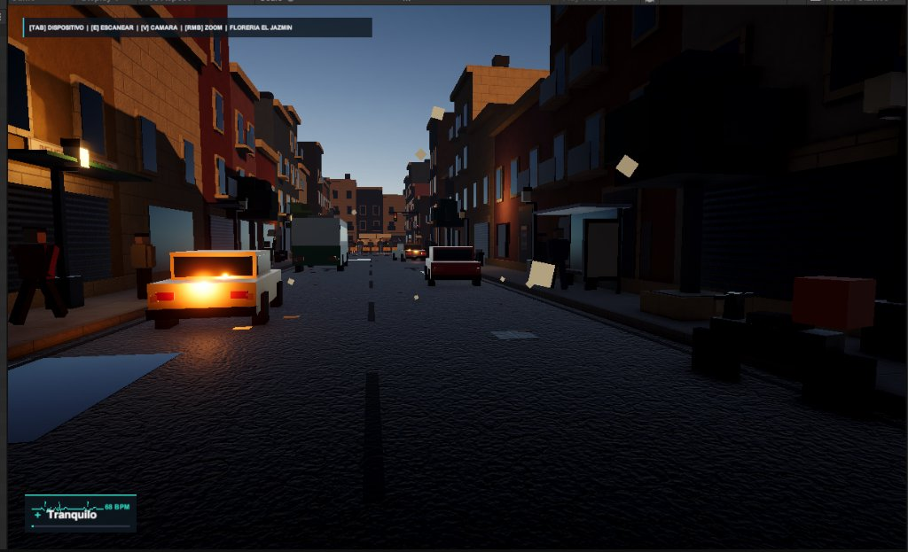
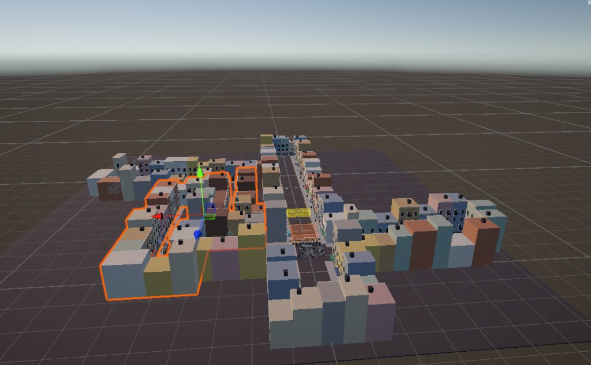
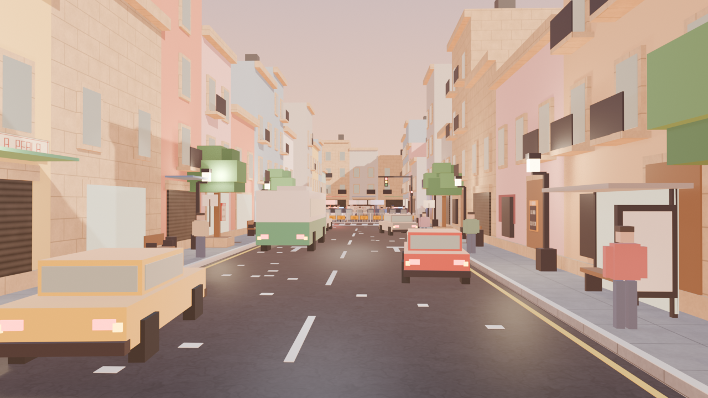
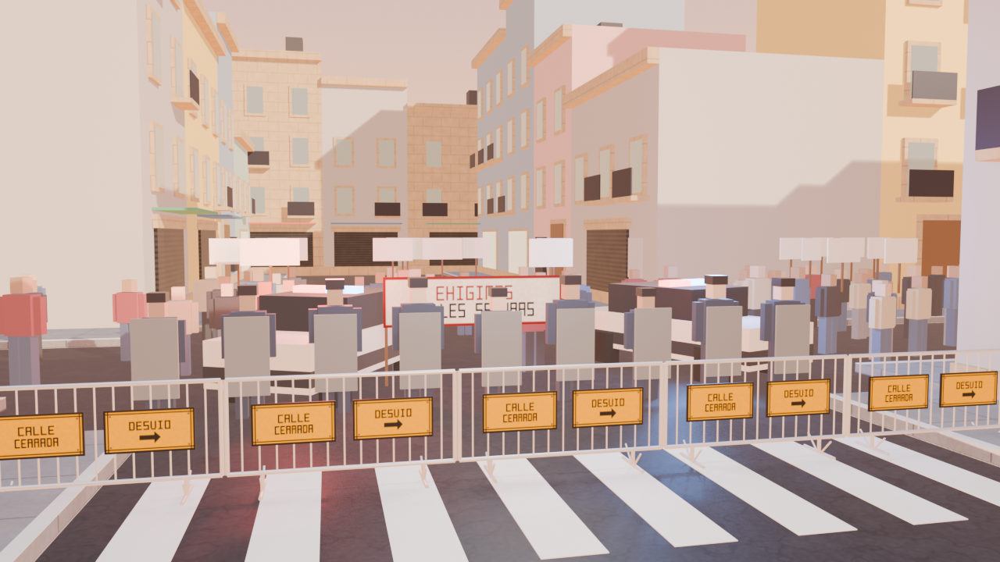
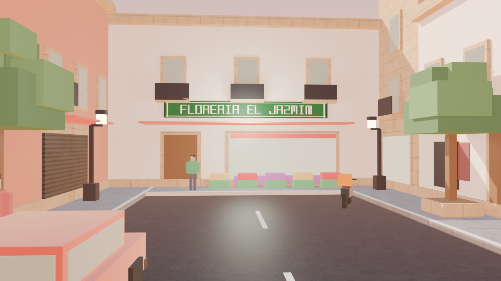
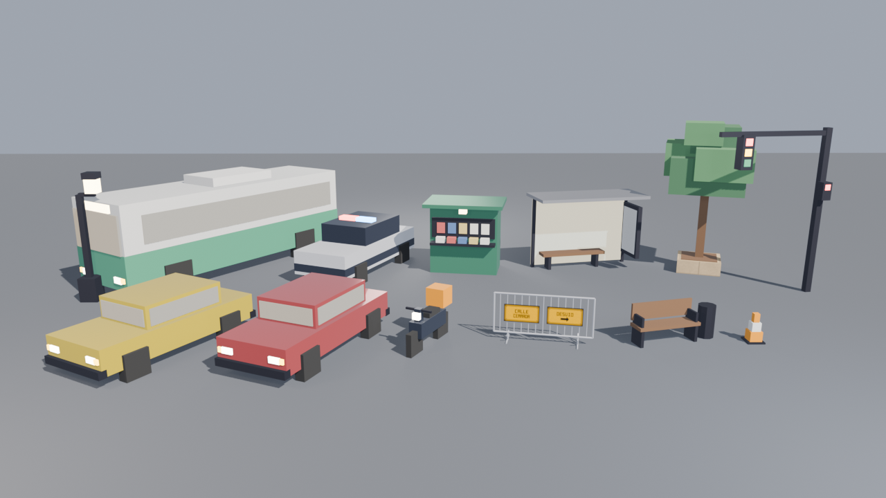
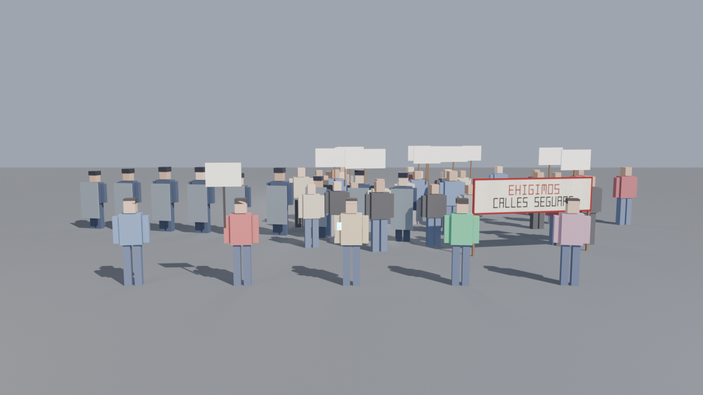

# Ruta Segura

> **Videojuego de simulacion narrativa, navegacion urbana, sigilo social y supervivencia no violenta en primera y tercera persona.**

Inspirado en acontecimientos urbanos reales en Guadalajara, Jalisco, Mexico. El jugador experimenta la vulnerabilidad de una persona comun que necesita atravesar una ciudad en constante cambio durante una jornada de manifestacion para cumplir un objetivo cotidiano sin recurrir a la violencia.

---

## Galeria Visual (Vertical Slice: "Las Flores")

### Gameplay en Unity 6 URP y Mapa Completo de la Ruta (~200 m)

| Gameplay en Av. Juarez (Trafico, Peaton y HUD) | Vista Aerea de la Ruta Completa en Unity |
| :---: | :---: |
|  |  |

### Recorrido Urbano: Edificios, Trafico, Barricada y Destino


*Av. Juarez: edificios de cantera y ladrillo con rotulacion tapatia, camion urbano, autos detenidos, puesto de periodicos, parada de camion, arborizacion y peatones.*

| Cierre Vial, Barricada ("La Muralla") y Protesta | Calle Hospital y Destino Final: Floreria El Jazmin |
| :---: | :---: |
|  |  |

### Catalogo 3D de Vehiculos, Mobiliario Urbano y Personajes


*Catalogo vehicular y mobiliario: camion urbano, patrulla, taxi, sedanes, moto de reparto, valla metalica (`CALLE CERRADA` / `DESVIO`), puesto de periodicos, parada, banca colonial, semaforo, farola y arbol en jardinera.*


*Poblacion y fuerzas de seguridad: cordon de policia con escudos, contingente de manifestacion con manta (`EXIGIMOS CALLES SEGURAS`) y transeuntes urbanos articulados.*

---

## Ficha Tecnica

| Parametro | Detalle |
|---|---|
| **Estado actual** | Fase 1 - Vertical Slice jugable ("Las flores", ~200 m) |
| **Motor** | Unity 6 (`6000.6.6f1 LTS`) |
| **Render Pipeline** | Universal Render Pipeline (`URP 17.6.0`, Forward+) |
| **Camara y Control** | Primera y Tercera persona (`[V]`/`[F5]`) + Zoom optico (`RMB`/`[Z]` + rueda), New Input System |
| **Pipeline 3D** | Blender `5.3.0` (`20` modelos FBX procedurales con transformacion baked-axis sin rotacion residual) |
| **Shaders Custom** | `7` shaders HLSL URP + `Complex Lit` con Clear Coat automotriz |
| **Audio** | Sintesis procedural 44.1 kHz en memoria + mezcla espacial 3D + filtro pasa-bajas dinamico |
| **Documento de Diseno** | [Game Design Document (GDD v9.0)](docs/GDD.md) |
| **Gobernanza de Estudio** | [Manifiesto de 5 Departamentos CCGS](docs/studio/STUDIO_MANIFEST.md) |

---

## Sistemas Implementados (Los 5 Departamentos del Estudio)

### 1. Departamento de Level Design, Shaders y Atmosfera URP
- **Recorrido continuo (~200 m):** `Av. Juarez` -> cierre en `Av. Hidalgo` -> `Callejon 1 (Del Refugio)` -> `Callejon 2` -> `Calle Hospital` -> `Floreria El Jazmin`, con banqueta elevada (`0.18 m`), machuelo, coladeras y volantes dispersos.
- **Ciudad Viva en Manifestacion (`20` modelos FBX):** camion urbano, taxis y sedanes variados detenidos, motocicletas de reparto, patrullas, vallas `CALLE CERRADA` / `DESVIO`, puestos de periodicos, paradas de camion, semaforos, bancas coloniales, contenedores y arboles en jardinera.
- **Pack Visual Realista v1 (7 shaders HLSL + Post-Procesado):**
  - `WetAsphaltPuddles.shader`: charcos organicos por ruido en espacio de mundo sobre `M_Asfalto_Calle` y `M_Concreto_Callejon`, oscurecimiento por humedad y micro-ondas reflejando farolas y torretas.
  - `InteriorMappingWindow.shader`: simulacion analitica 3D de cuartos iluminados/apagados detras del vidrio reflectante en edificios y aparadores.
  - `UrbanWeatheringWall.shader`: humedad basal en banquetas, escurrimientos verticales de lluvia y variacion tonal en fachadas.
  - `UrbanFoliageWind.shader`: balanceo suave de copas por viento sincronizado con sombras, translucidez SSS a contraluz y rescate de detalle en sombra.
  - `VolumetricLightHalo.shader`: conos volumetricos suaves bajo las `9` farolas guia con desvanecimiento por profundidad (`Soft Depth`).
  - `GuadalajaraSunsetSky.shader`: cielo crepuscular con disco solar y `2` capas de nubes procedurales animadas.
  - `HologramRouteRing.shader`: anillo holografico AR en asfalto con barrido radial de radar.
  - `Complex Lit` con Clear Coat en carrocerias vehiculares, `5` `ReflectionProbe` (`128 px`, proyeccion en caja), `ACES` + `Bloom` + `Split Toning` + `LiftGammaGain` + `FilmGrain` + `ScreenSpaceLensFlare`, farola parpadeante (`FlickeringStreetlamp`) y particulas suaves de polvo (`WindblownDebrisController`).

### 2. Departamento de Ingenieria Unity y UI
- **Controlador Dual de Perspectiva (`PlayerCameraController` + `PlayerAvatarVisual`):** transicion fluida 1ra / 3ra persona sobre el hombro con deteccion de muros (`SphereCast`), avatar articulado completo y zoom optico `1.4x` - `3.0x` en 1ra persona.
- **Poblacion Activa (`UrbanLifeController`):** `23` civiles, manifestantes con pancartas y observadores recorriendo banquetas y callejones con desvio lateral suave para no bloquear al jugador, luces intermitentes parpadeantes en autos, luces rojas en semaforos, dependiente que saluda al llegar a la floreria y `4` subtitulos breves en ruta.
- **HUD 100% uGUI (`TacticalHUDCanvas`, cero `OnGUI`):** ECG biometrico cardiaco inferior izquierdo (`CardiacBiometricHUD`), barra de objetivos superior y telefono diegetico `[TAB]` (`PhoneHUD`) con app de mapa 2D (`RutaLibre`) y red vecinal (`Eco Urbano`) con alertas push emergentes.
- **Escaner "Leyendo Entorno..." (`EnvironmentScanner`):** mantener `[E]`/`[Q]` llena el anillo radial, revela marcadores de desvio y proyecta `3` pines 3D con distancia (`BLOQUEO EN AV. HIDALGO`, `CORDON POLICIAL GALEANA`, `FLORERIA EL JAZMIN`).
- **Ciclo de Juego y Pausa (`GameLoopManager`):** tarjeta cinematica inicial `"MISION 1: LAS FLORES"`, transiciones `Intro -> Exploration -> Incident -> Detour -> Outcome`, menu de pausa `[ESC]` con control de volumen maestro persistente (`PlayerPrefs`) y reinicio rapido `[R]`.

### 3. Departamento de Narrativa Ambiental (Cero Emojis)
- **Identidad Tapatia Diegetica (`RoadSignTextureGenerator`):** rotulacion y placas integradas con UV exacto en muros y vallas: `NEVERIA LA PERLA`, `EX CONVENTO DEL CARMEN / CICLO DE CINE`, `EL INFORMADOR / CIERRES EN ZONA CENTRO`, stencil `CAMINAR SIN MIEDO`, placas `AV. JUAREZ` / `C. HOSPITAL`, manta `EXIGIMOS CALLES SEGURAS` y `FLORERIA EL JAZMIN`.

### 4. Departamento de Audio Diegetico y Reactivo
- **Libreria Procedural en Memoria (`ProceduralAudioLibrary`):** `10` tipos de audio sintetizados a `44.1 kHz` sin depender de archivos externos.
- **Biometria y Atmósfera (`BiometricAudioSystem`, `UrbanSoundscapeController`, `FootstepAudioController`):** pulso cardiaco dinamico de `68` a `148 BPM`, respiracion agitada progresiva al superar `50%` de amenaza, filtro pasa-bajas (efecto tunel auditivo), pasos sincronizados al ritmo de caminata/sprint, cierre de cortina metalica 3D en Av. Juarez, claxons intermitentes en la fila de trafico y murmullo/consignas espacializadas en Hidalgo y Galeana.

### 5. Departamento de QA y Telemetria
- **Telemetria en Vivo (`PerformanceTelemetryHUD`):** tecla `[F3]` muestra FPS, milisegundos por cuadro, fase del ciclo, porcentaje de amenaza, BPM, perspectiva, zoom y coordenadas exactas del jugador.
- **Auditoria Automatizada (`VerticalSliceQAAuditor`):** valida desde el menu de Unity que los bloques urbanos tengan colliders activos, orientacion horizontal, un solo `AudioListener`, `InputSystemUIInputModule`, shaders custom compilados, `Reflection_Probes` y materiales generados.

---

## Controles del Juego

| Entrada | Accion |
|---|---|
| `W A S D` / Flechas | Caminar por calzadas y banquetas |
| `Shift` | Correr |
| `Ctrl` / `C` | Agacharse |
| `V` / `F5` | Cambiar entre Primera y Tercera Persona |
| `Click Derecho` / `Z` (mantener) | Zoom optico en Primera Persona (`Rueda` ajusta `1.4x` - `3.0x`) |
| `E` / `Q` (mantener) | Escanear entorno y revelar pines 3D / rutas seguras |
| `TAB` | Abrir / cerrar telefono (`RutaLibre` y `Eco Urbano`) |
| `F3` | Mostrar / ocultar telemetria de rendimiento QA |
| `ESC` | Menu de pausa y volumen general |
| `R` | Reiniciar mision al llegar al desenlace |

---

## Como Abrir y Probar en Unity 6

1. Abre la carpeta `RutaSegura/` en **Unity Hub** con **Unity 6 (`6000.6.6f1 LTS`)**.
2. Al abrir la escena `Assets/Scenes/SampleScene.unity`, `AutoSceneConfigurator` prepara automaticamente materiales PBR/shaders, iluminacion, arquitectura y componentes en `GameManager` y `Player`.
3. Si regeneras modelos desde Blender (`blender.exe -b -P tools/build_ruta_larga.py`), ejecuta en Unity:
   - `Tools > Ruta Segura > Generar Paleta de Materiales Urbanos`
   - `Tools > Ruta Segura > Auto-Configurar Todo (1 Clic)`
   - `Tools > Ruta Segura > Ejecutar Auditoria QA (Vertical Slice)`
4. Pulsa **Play** para recorrer la ruta completa.

---

## Estructura del Repositorio

```text
Ruta-Segura-/
├── .agents/                    # Perfiles de estudio (5 departamentos CCGS + Agency)
├── docs/                       # Documentacion y galeria visual
│   ├── GDD.md                  # Game Design Document completo (v9.0)
│   ├── images/                 # Capturas de gameplay Unity y renders EEVEE del catalogo 3D
│   └── studio/                 # Manifiesto de estudio y guias tecnicas Unity
├── tools/
│   ├── build_ruta_larga.py     # Generador procedural Blender (20 FBX + layout_bounds.json)
│   └── render_readme_showcase.py # Generador de capturas de galeria en Blender EEVEE
└── RutaSegura/                 # Proyecto Unity 6 URP 17.6
    └── Assets/
        └── _Project/
            ├── Models/         # Architecture (4 FBX) + Props (16 FBX)
            ├── Materials/      # Materiales PBR, Complex Lit Clear Coat y rotulacion
            ├── Shaders/        # 7 shaders HLSL URP (asfalto humedo, ventanas 3D, follaje, cielo, etc.)
            ├── Textures/       # Texturas PBR procedurales y senaletica tapatia PNG
            ├── Scripts/
            │   ├── Runtime/    # Core, Player, UI, Audio, Events, Navigation, Threat, Mission
            │   └── Editor/     # AutoSceneConfigurator, StreetBuilder, Palette, Lighting, QAAuditor
            └── Scenes/         # SampleScene.unity
```
